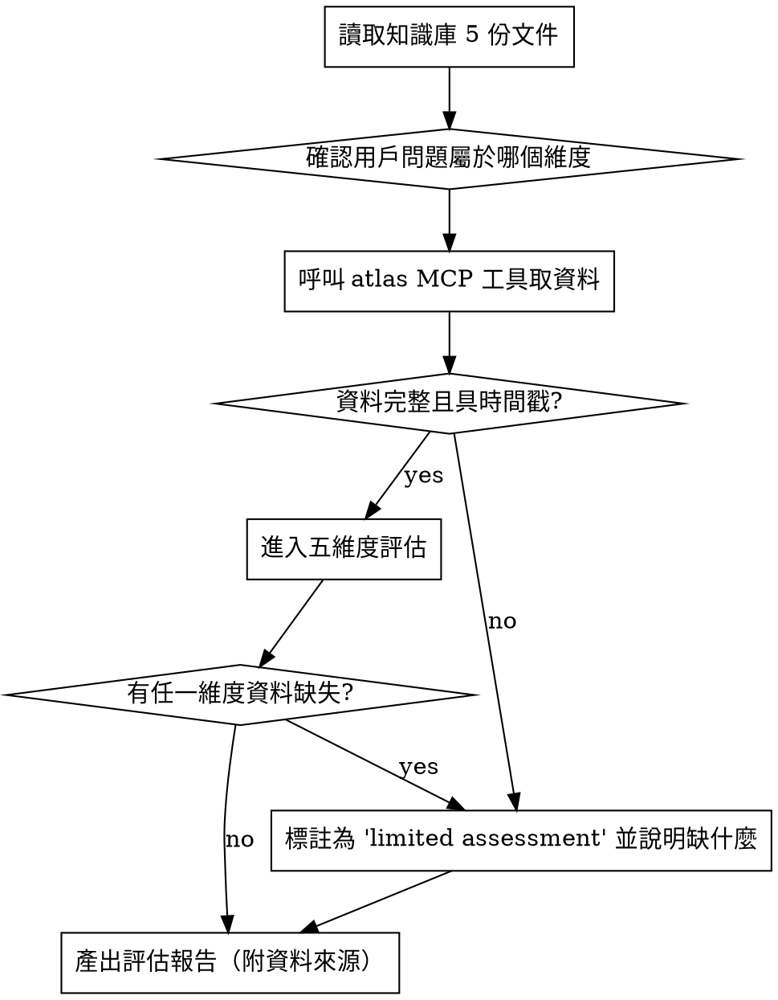

# 投資策略審查技能

## 概述

本技能為 atlas 台股平台的策略審查提供結構化框架。當用戶詢問策略評估、策略比較、策略排名、訊號策略表現時，agent 應載入本技能，遵循五維度審查框架，並依序呼叫 atlas MCP 工具取得資料，避免憑空推論或直接給出買賣建議。

**核心原則**：策略評估必須以平台回傳的結構化資料為基礎，所有結論需附上資料來源（strategy_id、time window、regime context），不臆測、不保證未來績效。

## 觸發條件

使用者出現下列任一意圖時，自動載入本技能：

| 類別 | 觸發詞 |
|------|--------|
| 策略評估 | 投資策略、策略評估、策略分析、策略檢視、策略表現 |
| 策略比較 | 策略比較、策略排名、策略對比、哪個策略好、A vs B |
| 訊號策略 | 訊號策略、信號策略、L1、L2、L3、L4、L5、技術訊號 |
| 權重機制 | Darwinian 權重、達爾文權重、權重動態調整、策略升降級 |
| 組合與配置 | 策略組合、資產配置、組合配置、投資組合、portfolio mix |
| 回測結果 | 回測結果、backtest、績效報告、歷史績效、勝率、Sharpe |
| 風險維度 | 風險調整後報酬、最大回撤、VaR、相關性、歸因 |

## 知識庫引用（必讀先行）

開始任何策略審查前，**先讀取**下列知識庫文件以建立共同語境：

1. **`~/workspace/atlas-wiki/index.md`** — 知識庫目錄總覽
2. **`{[[concepts/taiwan-financial-domain-model]]}`** — 金融術語字典（regime、Sharpe、VaR、drawdown 等的精確定義）
3. **`{[[concepts/atals-strategy-taxonomy]]}`** — 策略分類體系（L1-L5 對應什麼類型的訊號/策略）
4. **`{[[concepts/atals-simulation-guide]]}`** — 模擬結果的詮釋規則（如何讀 OOS 績效、statistical judge 結論、fallback 狀態）
5. **`{[[concepts/atals-mcp-tools-reference]]}`** — atlas MCP 工具分類與呼叫順序

> 不在 SKILL.md 重複這些文件的內容；遇到術語或流程不清楚時，必須回去查正本。

## 策略審查五維度框架

每個策略的評估必須涵蓋以下五個維度，缺一不可：

| 維度 | 問題 | 對應資料來源 |
|------|------|---------------|
| **1. 市場狀態契合度** | 該策略在當前 regime（RISK_ON / RISK_OFF / NEUTRAL / TRANSITIONAL）下是否被啟用？歷史在類似 regime 的表現如何？ | `regime_get_history` + `strategy_get_summary` 的 regime_aware 區塊 |
| **2. 歷史勝率與樣本數** | hit rate 多少？樣本數是否足以支撐結論（n≥30 為基本門檻）？統計顯著性（p-value）如何？ | `strategy_get_summary`（hit_rate, sample_size, statistical_significance） |
| **3. 風險調整後報酬** | Sharpe ratio、Sortino、Calmar ratio、最大回撤、VaR 95/99 — 不是只看絕對報酬。 | `risk_get_metrics` + `strategy_get_summary` |
| **4. 當前訊號強度** | 策略現在是否處於 active 觸發狀態？confidence score 多少？signal age 是否新鮮？ | `strategy_list_active` + `strategy_get` |
| **5. 與其他策略的相關性** | 此策略與現有組合中其他策略的相關性是否過高（>0.7 為高度相關警告）？是否會造成集中度風險？ | `risk_get_correlation_matrix` |

### 評估流程圖



## atlas MCP 工具使用指引

依審查階段呼叫對應工具，禁止跳過取資料步驟直接給結論：

### 階段 1：盤點現有策略

| 工具 | 用途 |
|------|------|
| `strategy_list_active` | 列出當前所有 active 訊號策略（L1-L5 detectors） |
| `strategy_get_layers` | 取得 L1-L5 策略層級配置全貌 |
| `strategy_ranker` | 取得目前依績效排序的策略排名（含免費/註冊/付費 tier 標記） |

### 階段 2：單策略深掘

| 工具 | 用途 |
|------|------|
| `strategy_get` | 取得單一策略完整 config + state |
| `strategy_get_summary` | 取得 hit rate、Sharpe、drawdown、regime 行為（評估維度 2、3、5） |
| `strategy_get_attribution` | 取得績效歸因（哪些條件/事件/特徵貢獻了該策略的 P&L） |
| `backtest_signals` | 取得 active signals 的 VaR / Sharpe / drawdown |
| `prism_get_training_results` | 取得 PRISM cohort 訓練結果（最新參數校準狀態） |

### 階段 3：組合與風險

| 工具 | 用途 |
|------|------|
| `risk_get_metrics` | 整體風險指標 |
| `risk_get_correlation_matrix` | 跨策略相關性矩陣（評估維度 5） |
| `risk_get_drawdown` | 當前回撤狀態 |
| `risk_exposure` | 產業 / factor / concentration 曝險 |
| `risk_get_calibration` | 風險模型校準度（預測 VaR vs 實際） |
| `synergy_get_darwinian_status` | Darwinian 權重當前狀態（哪些策略升/降權） |
| `synergy_get_darwinian_trend` | Darwinian 權重歷史趨勢 |

### 階段 4：情境與回測

| 工具 | 用途 |
|------|------|
| `experiment_history` | 實驗歷史（策略變體與 baseline 對比） |
| `experiment_diff` | 候選實驗 vs baseline 差異 |
| `experiment_judge` | 統計回放評分（Welch t-test、Sharpe 穩定度、OOS 驗證） |
| `backtest_status` | 最新回測整體狀態 |
| `report_get_performance` | 期間可配置的績效報告（含歸因與風險調整指標） |

## 策略比較與評估模板

### 模板 A：單策略評估報告

```markdown
## 策略評估報告：[strategy_id]

### 基本資料
- 策略 ID / 名稱：[from strategy_get]
- 啟用狀態：[active / paused / fallback]
- 當前權重：[from synergy_get_darwinian_status]
- 評估時間：[YYYY-MM-DD HH:MM]
- 資料來源：atlas MCP（strategy_id + window）

### 五維度評估

| 維度 | 評估結果 | 資料來源 |
|------|----------|----------|
| 1. 市場狀態契合度 | [說明 regime 對應] | regime_get_history |
| 2. 歷史勝率 | [hit_rate]（n=[sample_size]） | strategy_get_summary |
| 3. 風險調整後報酬 | Sharpe=[X], MaxDD=[Y]% | strategy_get_summary |
| 4. 當前訊號強度 | [confidence / signal age] | strategy_list_active |
| 5. 與其他策略相關性 | [最高相關策略]=[r] | risk_get_correlation_matrix |

### 結論
- **資料充分度**：[complete / limited — 缺什麼]
- **整體評估**：[依上述五維度綜合]
- **不確定性**：[顯著性、樣本數、regime 偏移等]
- **下一步建議**：[是否適合加入當前組合 / 需再觀察 / 需做歸因深掘]
```

### 模板 B：多策略比較表

```markdown
## 策略比較報告

比較對象：[strategy_id_1] vs [strategy_id_2] vs [strategy_id_3]
比較期間：[time window]
評估時間：[YYYY-MM-DD HH:MM]

| 維度 | Strategy A | Strategy B | Strategy C |
|------|-----------|-----------|-----------|
| 1. 當前 regime 契合度 | [✓/✗/⚠] | [✓/✗/⚠] | [✓/✗/⚠] |
| 2. Hit rate (n=) | [X% (n=)] | [X% (n=)] | [X% (n=)] |
| 3. Sharpe | [X] | [X] | [X] |
| 3. Max DD | [X%] | [X%] | [X%] |
| 4. 當前訊號 | [active/cooldown] | [active/cooldown] | [active/cooldown] |
| 5. 與組合相關性 | [平均 r=X] | [平均 r=X] | [平均 r=X] |

### 比較結論
- **互補性**：[哪些策略在維度 X 上互補]
- **集中度風險**：[相關性 > 0.7 的策略對]
- **建議組合**：[基於上述維度的權重建議，但需遵守「不給具體買賣建議」邊界]
```

### 模板 C：Darwinian 權重審查

```markdown
## Darwinian 權重審查報告

評估對象：當前生效的 Darwinian 權重機制
評估時間：[YYYY-MM-DD HH:MM]

### 當前權重狀態
- [strategy_id_1]：[weight_delta]（升/降/不變）
- [strategy_id_2]：[weight_delta]
- ...

### 過去 N 天趨勢
[from synergy_get_darwinian_trend]

### 風險評估
- 權重變動是否過於劇烈（單日 >X% 為警告）？
- 是否有策略被連續降權到接近 0？（觀察是否要停用）
- 升權策略是否在當前 regime 真的有 edge？

### 結論
[整體評估]
```

## 紅旗清單（Red Flags）

出現以下情況時，**停止並回到資料來源**：

- 「我看起來這個策略最近表現不錯」——沒附 strategy_id + window + 物理資料來源 → 回去用 strategy_get_summary
- 「建議你買 XX」——本技能禁止給出具體買賣建議
- 「這個策略未來會賺錢」——禁止保證未來績效
- 「勝率 100%」——這是 overfit 或樣本數過少的訊號
- 同一份評估報告裡 hit rate 與 Sharpe 引用不同 time window 但未標註 → 回去重抓資料
- 引用「相關性」但沒有說明是 strategy-strategy 還是 strategy-factor → 需明確標註

## 風險提醒

- **過去績效不代表未來表現**：所有 Sharpe / hit rate 數字僅反映歷史，不代表未來續航力。
- **regime 偏移**：策略在 RISK_ON 訓練的參數，在 RISK_OFF 可能失效；評估必須帶 regime context。
- **樣本數不足**：n < 30 的策略評估，信心度必須標註為「low confidence」。
- **OOS 驗證**：未通過 out-of-sample 驗證的策略僅供研究，不可進入正式組合。
- **statistical significance**：p-value > 0.05 的差異，應視為「無統計顯著差異」，不可聲稱 X 優於 Y。
- **本技能不取代專業投顧**：所有結構化評估僅供平台用戶理解策略表現，不構成任何投資建議。

## 參見

- 知識庫索引：`~/workspace/atlas-wiki/index.md`
- 策略分類：`{[[concepts/atals-strategy-taxonomy]]}`
- 風險管理：`{[[concepts/atals-risk-management-framework]]}`
- 模擬結果詮釋：`{[[concepts/atals-simulation-guide]]}`
- 平台總覽：`{[[concepts/atals-platform-overview]]}`
- atlas MCP 工具：`{[[concepts/atals-mcp-tools-reference]]}`
- 領域模型（術語字典）：`{[[concepts/taiwan-financial-domain-model]]}`
- 姊妹技能：`taiwan-market-analysis`（台股市場結構與技術分析）
